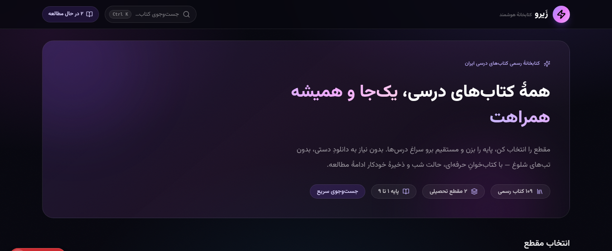
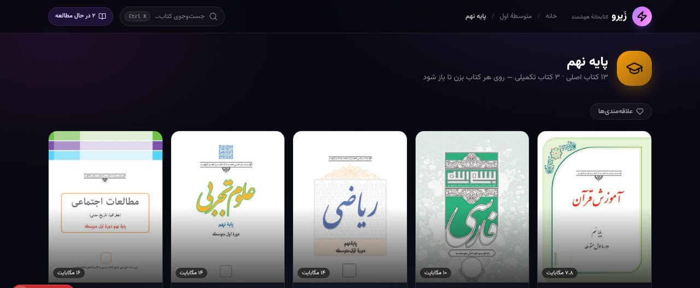
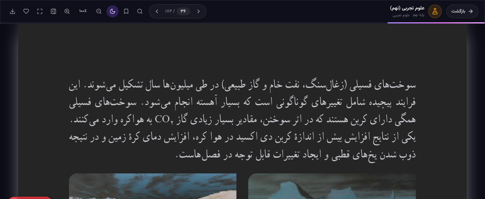

<div align="center">


# 📚 Zayro — زیرو

**کتابخانهٔ هوشمند و کاملاً آفلاین کتاب‌های درسی ایران — پایهٔ ۱ تا ۹**

[](../../releases)
[](#-دانلود-نسخهٔ-ویندوز)
[](https://nextjs.org)
[](https://electronjs.org)
[](LICENSE)

*همهٔ کتاب‌های درسی، یکجا و همیشه همراهت*

</div>

---

Zayro یک اپلیکیشن فارسی برای مطالعهٔ **۱۰۹ کتاب درسی رسمی** پایهٔ اول دبستان تا نهم متوسطهٔ اول است؛ هم به‌صورت **اپ دسکتاپ ویندوز** و هم به‌صورت **وب‌اپ**. با رندر صحیح متن فارسی، ناوبری هوشمند **مقطع ← پایه ← درس** و یک PDFخوان واقعاً پیشرفته.

| صفحهٔ اصلی | منوی پایه (کتب همان پایه) |
|:---:|:---:|
|  |  |
| **حالت شب — کتابخوان** | |
|  | |

---

## ✨ امکانات

- **۱۰۹ کتاب رسمی** پایهٔ ۱ تا ۹ — بدون نیاز به هیچ اقدامی از طرف کاربر
- **ناوبری سلسله‌مراتبی:** ابتدایی / متوسطهٔ اول ← پایه ← منوی PDFهای همان پایه با کاور واقعی هر کتاب
- **منوی هوشمند هر پایه:** فیلتر درس‌ها بر اساس موضوع، جست‌وجوی زندهٔ درون‌پایه‌ای، دو حالت نمایش کارت/فهرست و نوار «ادامهٔ مطالعه»
- **PDFخوان پیشرفته:**
  - رندر lazy صفحات (فقط صفحات نزدیک viewport) با صف رندر و سقف پیکسل
  - رفع کامل مشکل متن فارسی (cmaps + standard fonts ادغام‌شده)
  - حالت شب مخصوص مطالعه در تاریکی
  - جست‌وجوی متن فارسی با نرمال‌سازی حروف (ی/ک عربی و فارسی)
  - نشانک، علاقه‌مندی، ریل تامبنیل صفحات، تمام‌صفحه
  - ذخیرهٔ خودکار «ادامهٔ مطالعه» و بازگشت دقیق به همان صفحه
- **جست‌وجوی سراسری** بین همهٔ کتاب‌ها و درس‌ها (Ctrl+K)
- **کاملاً آفلاین** بعد از آماده‌سازی — بدون تبلیغ، بدون حساب کاربری
- فونت **Vazirmatn** برای رابط کاربری

---

## 📥 دانلود نسخهٔ ویندوز

به صفحهٔ [**Releases**](../../releases) بروید و بستهٔ متناسب با سیستم‌تان را انتخاب کنید:

| فایل | مناسب برای |
|---|---|
| `Zayro-Setup-x64.exe` | 🪟 ویندوز ۶۴ بیتی — نصب با شورتکات (پیشنهادی) |
| `Zayro-Setup-ia32.exe` | 🪟 ویندوز ۳۲ بیتی — نصب |
| `Zayro-Portable-x64.exe` | 🎒 اجرای بدون نصب — ۶۴ بیتی |
| `Zayro-Portable-ia32.exe` | 🎒 اجرای بدون نصب — ۳۲ بیتی |

> 💡 **دفعهٔ اول که اجرا کنید:** اپ به‌صورت هوشمند همهٔ ۱۰۹ کتاب را از سرور رسمی سازمان پژوهش و برنامه‌ریزی آموزشی (`chap.sch.ir`) دانلود می‌کند — با صف دانلود، تلاش مجدد خودکار و اعتبارسنجی فایل‌ها. به همین دلیل حجم فایل‌های exe سبک (~۹۰MB) است. بعد از آن **همه‌چیز کاملاً آفلاین** است و هر بار که کتابی را باز کنید، در اولویت دانلود قرار می‌گیرد.

---

## 🌐 اجرای نسخهٔ وب

```bash
# نصب وابستگی‌ها
bun install        # یا: npm install

# حالت توسعه
bun run dev        # یا: npm run dev
```

سپس مرورگر را باز کنید: **http://localhost:3000**

> نسخهٔ وب کتاب‌ها را از `public/books/` می‌خواند؛ برای پر کردن آن:
> ```bash
> pip install requests beautifulsoup4
> python scripts/download_books.py    # دانلود ۱۰۹ کتاب به public/books/
> ```

---

## 📁 ساختار پروژه

```
├── public/
│   ├── pdfjs/               # cmaps + فونت‌های استاندارد pdf.js (کلید رندر فارسی)
│   └── fonts/               # فونت Vazirmatn
├── src/
│   ├── app/                 # اپ Next.js (App Router)
│   ├── components/library/  # HomeView, StageView, GradeView, BookCard,
│   │                        # Reader, SearchOverlay, ThumbCover
│   └── lib/
│       ├── books-data.ts    # کاتالوگ هوشمند ۱۰۹ کتاب (۲۰ موضوع با آیکون و رنگ)
│       ├── pdf-engine.ts    # موتور رندر PDF (کش سند + صف رندر + سقف پیکسل)
│       ├── library-store.ts # استور سراسری (useSyncExternalStore)
│       └── desktop.ts       # تشخیص محیط دسکتاپ + هماهنگی با دانلودر
├── desktop-build/           # ساخت اپ دسکتاپ ویندوز
│   ├── runtime/             # main.js (سرور محلی + Range) و sync.js (دانلودر هوشمند)
│   ├── nsis-src/            # اسکریپت‌های NSIS نسخهٔ Setup و Portable
│   ├── inject-resources.js  # تزریق آیکون/متادیتا به exe (بدون نیاز به Wine)
│   └── zayro.ico
├── scripts/                 # اسکرپ و دانلود کتاب‌ها از chap.sch.ir
│   ├── scrape_chap.py       # استخراج فهرست کتاب‌ها
│   ├── download_books.py    # دانلود و اعتبارسنجی PDFها
│   ├── gen_books_data.py    # تولید src/lib/books-data.ts
│   └── gen_nsis.py          # تولید اسکریپت‌های نصب‌کننده
└── docs/screenshots/        # تصاویر پیش‌نمایش
```

---

## 🔄 به‌روزرسانی کتاب‌ها (اختیاری)

اگر خواستید کتاب‌های چاپ جدید اضافه کنید:

```bash
pip install requests beautifulsoup4
python scripts/scrape_chap.py      # استخراج لینک‌ها از chap.sch.ir
python scripts/download_books.py   # دانلود به public/books/
python scripts/gen_books_data.py   # بازتولید کاتالوگ
```

---

## 🛠 ساخت نسخهٔ ویندوز از سورس

1. نسخهٔ وب را با `output: 'export'` بیلد کنید → `app-dist`
2. با `scripts/download_electron.sh` ران‌تایم Electron win32 (x64/ia32) را بگیرید
3. با `desktop-build/inject-resources.js` آیکون و متادیتا را به `Zayro.exe` تزریق کنید
4. با `python scripts/gen_nsis.py` اسکریپت‌های NSIS را بسازید و با `makensis` کامپایل کنید

خروجی: ۴ فایل `Zayro-Setup/Portable` برای `x64/ia32` — همان فایل‌های صفحهٔ Releases.

---

## 🧩 تکنولوژی‌ها

Next.js 16 · React 19 · TypeScript · Tailwind CSS 4 · shadcn/ui · pdf.js 6 · Electron 38 · Framer Motion

---

## 📄 مجوز

- کد پروژه تحت مجوز [MIT](LICENSE) منتشر شده است.
- کتاب‌های درسی متعلق به **وزارت آموزش و پرورش** و **سازمان پژوهش و برنامه‌ریزی آموزشی** است و از درگاه رسمی [chap.sch.ir](https://chap.sch.ir) دریافت می‌شوند. این پروژه صرفاً یک کتابخوان مستقل است.
- فونت [Vazirmatn](https://github.com/rastikerdar/vazirmatn) تحت مجوز OFL منتشر شده است.
